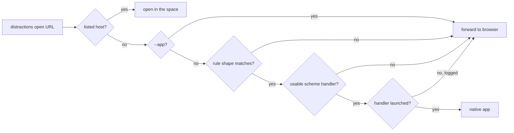

# Links a native app can open hand off to that app

## Conversation Evidence

> user (turn 1, relayed bug report from another session): "when distraction-space is the default browser, open.spotify.com links open the Spotify web player in the browser instead of the Spotify desktop app."
> user (turn 1, relayed): "Expected: open.spotify.com/{track,album,playlist,artist,episode,show}/<id> (with or without the intl-xx/ prefix and ?si= query) opens in the Spotify app as spotify:<type>:<id>, via the spotify: scheme handler. Anything that can't be mapped (/user/..., the homepage, etc.), or a system with no spotify: handler, should keep forwarding to the browser as it does now."
> user (turn 2): "/flow-next:capture the generic spec that'll allow for any native app link to work properly"
> user (turn 3, selected): "Shipped + user config (Recommended)"
> user (turn 3, selected): "Spotify + common ones"

Facts established on 2026-10-20 by reading the code and the relayed diagnosis. The plugin's desktop entry is the default handler for http and https, so every web link the desktop opens goes through `distractions open`. Target resolution sends an http(s) URL whose host is listed into the space and forwards every other one to the previously recorded browser handler. On the reporting machine `x-scheme-handler/spotify` resolves to `spotify.desktop` (`spotify --uri=%u`), and the desktop app claims no https links, so before the plugin took over https the browser also loaded the web player.

## Goal & Context
<!-- scope: business -->

A link to something a native app on this machine can show opens in that app, not in the work browser [paraphrase]. The plugin sits in front of every http(s) open, so it is where these links can be routed [paraphrase]. The mechanism is generic: rules map web links to an app's own URI scheme, the plugin ships rules for Spotify and a few common apps, and the person can add their own in config so any native app link can be made to work without a plugin release [paraphrase].

## Architecture & Data Models
<!-- scope: technical -->

**A handoff rule** names an app, the target scheme, the hosts it applies to, and one or more link shapes. A shape fully matches the URL path (an optional leading segment such as Spotify's `intl-xx` is part of the pattern), may read named query parameters, each with its own allowed-character pattern and a required flag, and renders a URI template from the named captures. One placeholder stands for the whole original URL, for apps whose scheme wraps a web URL (Steam's `steam://openurl/<url>`).

**Two sources, one ordered list.** Shipped rules are plugin data beside the catalog. The person's rules sit under one config key holding a list of rules and a list of shipped app names turned off. Order: the person's rules in file order, then the shipped rules that are neither turned off nor replaced; a person rule whose app name equals a shipped one replaces it.

**Where it runs.** Target resolution is unchanged. When `open` is about to forward an http(s) link, it first checks the rules; a link opened with `--app` (an Omarchy web-app entry the person made) skips the check, since the person chose a web app for it. Only after a shape matches is the handler looked up, so a link no rule recognises costs nothing new.

**A usable handler** is the desktop id `xdg-mime query default x-scheme-handler/<scheme>` prints, whose desktop file exists, which is neither the plugin's own entry nor the recorded previous browser handler, and whose Exec line has a URL field code to carry the URI. The app is launched from that entry directly, detached and outside the space, never through `xdg-open`, which would route web URLs back to the plugin. Browser flags passed to `open` are not applied to a handoff and are logged as such, the way a space launch logs them.



## Edge Cases & Constraints
<!-- scope: technical -->

- Host matching is exact on the lowercased host with a trailing dot removed; a rule lists every host it covers. A non-default port or userinfo in the authority means no match. Both http and https match.
- Path literals are case-sensitive. A captured value is checked against its allowed characters before any percent-decoding, and the default allowed set excludes `%`, `/`, whitespace and control characters, so an encoded or crafted value means no match and nothing extra reaches the app's URI. The fragment is ignored; unnamed query parameters are ignored; a named one is read from its first occurrence.
- The whole-URL placeholder is only valid for a rule restricted to the app's own hosts, and it renders only when the whole URL is free of whitespace, quotes, angle brackets, backslashes and control characters; otherwise the shape does not match.
- A rule's target scheme must be a well-formed scheme name and none of http, https, file, about, javascript, data, ftp, mailto, ws or wss.
- Config validation stays strict about the key's outer shape (a list of rule objects and a list of names), so `config set` refuses a value of the wrong type. A rule with a missing or unknown field, a bad pattern or a refused scheme is skipped when rules are loaded and reported back to the caller, which writes one log line per open naming it; the others apply. The rule engine does not log or launch.
- `xdg-mime` missing, failing, timing out or printing nothing means no handler, silently. A handler fails to start when it cannot be spawned or exits non-zero within the launch settle window every detached launch already uses; the launcher's own failure line is the one log line, and the link forwards. An exit after that window is not observed.
- The handoff log names the app and the handler's desktop id, never the mapped URI or the link, since those can carry secrets such as a meeting password.
- Handing off launches the app outside the space. That is right for an unlisted app and is why listed hosts keep their current path: a listed distraction never escapes containment through a rule.

## Acceptance Criteria
<!-- scope: both -->

- **R1:** An http(s) link with an unlisted host that a rule recognises, opened without `--app`, opens through that rule's scheme handler as the mapped URI, and no browser opens; for Spotify, `open.spotify.com/{track,album,playlist,artist,episode,show}/<id>`, with or without the `intl-xx/` prefix and the `?si=` query, opens as `spotify:<type>:<id>`. Errors: `xdg-mime` missing, failing or silent; a handler whose desktop file is missing; a handler that is the plugin's entry or the recorded browser; a handler whose Exec cannot carry the URI → the link forwards as today; the handler failing to start (not spawned, or a non-zero exit within the launch settle window) → the link forwards and exactly one line is logged.
- **R2:** A link no rule recognises, including a recognised host with an unmappable path (`/user/...`, the homepage), and any link opened with `--app`, forwards to the browser exactly as today, with no `xdg-mime` call (no error surface beyond R1).
- **R3:** A link whose host is listed opens in the space exactly as today, even when a rule would recognise it (no error surface beyond the existing listed path).
- **R4:** The person can add rules in config, replace a shipped rule by its app name, and turn a shipped rule off, with the order in Architecture. Errors: a value of the wrong outer shape → `config set` refuses it; a malformed rule, one with an unknown field, or one whose target scheme is refused → that rule is skipped with one log line and the others apply.
- **R5:** A captured value containing a character its shape does not allow, a percent-encoded value, a non-default port, userinfo, or a whole URL with a forbidden character makes the shape not match, so the link forwards (no error surface beyond R2).
- **R6:** The plugin ships rules for Spotify, Zoom, Slack, Steam, Discord and Telegram, each tested against example links of every recognised shape and at least one unmappable link. The pull request names each app's scheme source, and an app whose mapping cannot be confirmed is left out and named there.
- **R7:** `docs/reference.md` describes the handoff, the order, the rule format with an example of a person-defined rule, and the `--app` exception; `docs/internals.md` places it in the `open` resolution order and lists the new test fake; `manifest.json` carries 3.5.0.

## Early proof point

Task fn-47-links-a-native-app-can-open-hand-off-to.1 validates the core approach (a data-driven Spotify rule handed to a fake `spotify:` handler through the real `open` path, with every fallback forwarding). If it fails, re-evaluate the rule format and the hook point before continuing with .2+.

## Boundaries
<!-- scope: business -->

- Not changing what happens to a listed host's links, nor launching a listed app's native client from a link.
- No per-open override to force the browser for a link a rule recognises; turning the rule off in config is the way.
- No handoff for schemes other than http and https arriving at the plugin.
- No caching of handler lookups and no status or doctor listing of active rules.

## Decision Context
<!-- scope: both -->

A Spotify special case was rejected for a generic rule mechanism with Spotify as one entry, so apps can be added as data and by the person without a plugin release [paraphrase]. Shipping rules only in the plugin was rejected because the person wants any native app link to work [paraphrase]. `--app` skips the handoff because those entries are web apps the person installed on purpose. Launching through `xdg-open` was rejected because the plugin is the web handler and a wrapped URL could come back to it. The version moves to 3.5.0 since this adds a feature.

## Quick commands

```bash
PATH=/usr/bin:$PATH python3 -m unittest tests.test_launch tests.test_handoff tests.test_config
```

## Requirement coverage

| Req | Description | Task(s) | Gap justification |
| --- | --- | --- | --- |
| R1 | An http(s) link with an unlisted host that a rule recognises, opened without `--app`, opens through that rule's scheme handler as the mapped URI, and no browser opens; for Spotify, `open.spotify.com/{track,album,playlist,artist,episode,show}/<id>`, with or without the `intl-xx/` prefix and the `?si=` query, opens as `spotify:<type>:<id>`. Errors: `xdg-mime` missing, failing or silent; a handler whose desktop file is missing; a handler that is the plugin's entry or the recorded browser; a handler whose Exec cannot carry the URI → the link forwards as today; the handler failing to start (not spawned, or a non-zero exit within the launch settle window) → the link forwards and exactly one line is logged. | fn-47-links-a-native-app-can-open-hand-off-to.1 | — |
| R2 | A link no rule recognises, including a recognised host with an unmappable path (`/user/...`, the homepage), and any link opened with `--app`, forwards to the browser exactly as today, with no `xdg-mime` call (no error surface beyond R1). | fn-47-links-a-native-app-can-open-hand-off-to.1 | — |
| R3 | A link whose host is listed opens in the space exactly as today, even when a rule would recognise it (no error surface beyond the existing listed path). | fn-47-links-a-native-app-can-open-hand-off-to.1 | — |
| R4 | The person can add rules in config, replace a shipped rule by its app name, and turn a shipped rule off, with the order in Architecture. Errors: a value of the wrong outer shape → `config set` refuses it; a malformed rule, one with an unknown field, or one whose target scheme is refused → that rule is skipped with one log line and the others apply. | fn-47-links-a-native-app-can-open-hand-off-to.2 | — |
| R5 | A captured value containing a character its shape does not allow, a percent-encoded value, a non-default port, userinfo, or a whole URL with a forbidden character makes the shape not match, so the link forwards (no error surface beyond R2). | fn-47-links-a-native-app-can-open-hand-off-to.1 | — |
| R6 | The plugin ships rules for Spotify, Zoom, Slack, Steam, Discord and Telegram, each tested against example links of every recognised shape and at least one unmappable link. The pull request names each app's scheme source, and an app whose mapping cannot be confirmed is left out and named there. | fn-47-links-a-native-app-can-open-hand-off-to.3 | — |
| R7 | `docs/reference.md` describes the handoff, the order, the rule format with an example of a person-defined rule, and the `--app` exception; `docs/internals.md` places it in the `open` resolution order and lists the new test fake; `manifest.json` carries 3.5.0. | fn-47-links-a-native-app-can-open-hand-off-to.4 | — |
